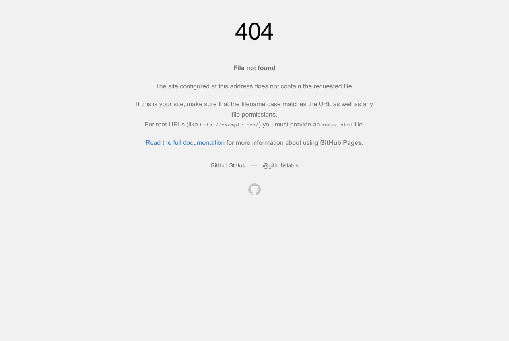
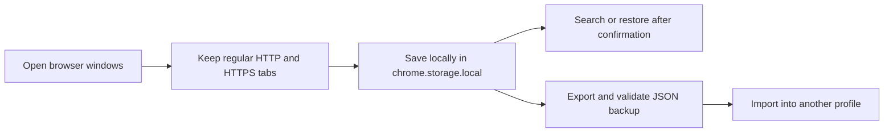

# TabHarbor

**Your sessions, at anchor.**



TabHarbor is a Manifest V3 extension for Chrome and Edge that saves named browser workspaces, searches saved tabs, and restores each saved window in one step. Session data stays in the extension's local storage; there is no account, server, analytics, content script, or remote API.

## Features

- Save regular HTTP and HTTPS tabs across up to 50 normal windows, with at most 500 unique tabs per window; over-limit saves are rejected without truncation.
- Restore a saved workspace as separate browser windows, preserving tab order and pinned state.
- Search session names, page titles, and URLs.
- Export one session or the library as JSON, then validate JSON backups before import.
- Keep up to 100 saved sessions. An import that would exceed the limit is rejected without truncating saved or imported sessions; entries with the same name and creation time are treated as duplicates, and existing entries are kept.
- Deduplicate canonical URLs per saved window and discard unsupported schemes.
- Keyboard shortcut `Ctrl/⌘ + K` focuses the search field.

## Typical workflows

1. **Research:** save several open windows as one named workspace, then restore them later with their original tab order.
2. **Project handoff:** search saved titles and URLs, export the relevant workspace as JSON, and archive or share that backup deliberately.
3. **Move to another browser profile:** export the library, install TabHarbor in the destination profile, and import the JSON there.



## Install for testing

1. Download the `TabHarbor` ZIP from the [latest release](https://github.com/GhosTnever-lkm/tabharbor/releases/latest) and extract it.
2. In Chrome, open `chrome://extensions`; in Edge, open `edge://extensions`.
3. Turn on Developer mode, choose **Load unpacked**, and select the extracted folder containing `manifest.json`.
4. Pin TabHarbor to the toolbar and open the popup.

Browser extension stores require separate submissions; the GitHub release is a downloadable unpacked extension, not a store listing.

## Permissions and data

- `tabs` lets the popup read tab titles, URLs, pinned state, and window membership so it can save sessions. No page content is read.
- `storage` keeps the session list in `chrome.storage.local` on this browser profile.
- No host permissions are requested. The extension makes no network requests.
- Saved URLs and titles can reveal browsing habits. Local extension storage and exported JSON are not encrypted. Use the export carefully on shared devices.
- Restoring asks before opening windows. Removing a saved record does not close existing tabs.

## Development

Requires Node.js 20 or newer for the pure core checks:

```sh
npm run check
```

The session validation and backup logic is covered by automated tests. The extension has no build step or runtime dependencies.

## ☕ Support / Pro Version

TabHarbor is free and open source under MIT. There is no separate Pro edition. If the project is useful, you can support GhosTnever on [Boosty](https://boosty.to/azizazimov) or [Buy Me a Coffee](https://buymeacoffee.com/azizazimov8).

Crypto donations are also welcome. Send only the matching asset on its listed network:

| Network | Receive address |
|:--|:--|
| Bitcoin | `bc1qn75pj4n7gyl2k5kf2f97elvyenz52q6nn2g30u` |
| TRON | `TCBSy38X57hA6w2onJcxom24x1febc1mP1` |
| BNB Smart Chain | `0xD431a917961E0b086B96D9F72b5C8fF19b19068a` |

## License

MIT. See [LICENSE](LICENSE).
